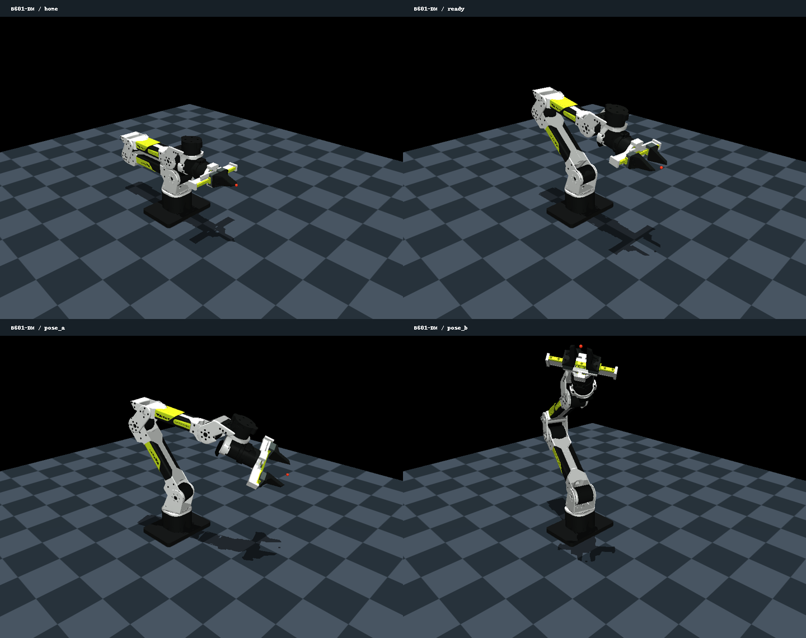

# B601-DM MuJoCo Simulation

Modular ROS 2 Humble simulation package for the reBotArm B601-DM robot arm featuring MuJoCo physics, `ros2_control`, MoveIt 2 motion planning, and high-level mission tasks.

---

## Architecture Overview

```text
rebotarm_mujoco_dm/
├── config/
│   ├── controllers.yaml               # ros2_control hardware interface overrides
│   ├── rviz.rviz                      # RViz display configuration
│   ├── scenes/                        # Scene-specific task parameters
│   │   ├── rail_scan_params.yaml      # Coordinates, dwell times, puzzle map
│   │   ├── bowl_params.yaml           # Single bowl transfer parameters
│   │   └── two_bowls_params.yaml      # Two-bowl batch parameters
│   └── urdf/                          # Robot URDF & ros2_control descriptions
│       ├── rebotarm_dm.urdf.xacro
│       └── rebotarm_dm.ros2_control.xacro
├── launch/
│   └── simulation.launch.py           # Unified launch file (scene:=...)
├── models/
│   ├── robot/                         # Pure arm MJCF definition
│   │   └── dm_arm.xml
│   └── scenes/                        # Environment & task MJCF models
│       ├── dm_rail_scan.xml           # 3 sorting rails, optical scan station, 6 balls
│       ├── dm_two_bowls.xml           # 2 wooden bowls, 5 balls
│       ├── dm_bowl.xml                # 1 wooden bowl, 1 ball
│       ├── dm_table.xml               # Wood table, 1 ball
│       └── dm_empty.xml               # Clean robot-only scene
├── rebotarm_mujoco_dm/
│   ├── bridge/                        # MoveIt & scene perception bridge
│   │   ├── scene_bridge.py            # Free joint / collision object publisher
│   │   ├── scene_geometry.py          # Collision shape extractors
│   │   ├── pose_adapter.py            # Action server bridging MoveToPose
│   │   └── pose_requests.py           # Trajectory request builders
│   ├── core/                          # Reusable grasping & motion primitives
│   │   ├── arm_interface.py           # Clean ROS 2 action/service client wrapper
│   │   └── grasp_checks.py            # Slip, hold, and contact verifiers
│   └── tasks/                         # High-level mission orchestrators
│       ├── rail_scan_mission.py       # Pick -> Scan -> Sort puzzle mission
│       └── bowl_transfer_mission.py   # Multi-ball bowl transfer mission
└── docs/                              # Centralized documentation and validation notes
```

---

## Quick Start: Unified Launch & Missions

### 1. Build the Workspace
```bash
cd ~/si_ware/documents/rebot_arm_b601/ws_projects
source /opt/ros/humble/setup.bash
colcon build --symlink-install --packages-select rebotarm_mujoco_dm
source install/setup.bash
```

### 2. Launch Simulation (Terminal 1)
Launch the unified simulation stack with your desired scene (`rail_scan`, `two_bowls`, `bowl`, `table`, `empty`):

```bash
export ROS_DOMAIN_ID=76 ROS_LOCALHOST_ONLY=1
ros2 launch rebotarm_mujoco_dm simulation.launch.py scene:=rail_scan use_moveit:=true
```

### 3. Run Mission Task (Terminal 2)
```bash
export ROS_DOMAIN_ID=76 ROS_LOCALHOST_ONLY=1
ros2 run rebotarm_mujoco_dm rail_scan_mission
# Or legacy alias:
ros2 run rebotarm_mujoco_dm rail_scan_cycle
```

---

## Supported Scenes

| Scene Name | Model XML | Description | Mission Node |
| :--- | :--- | :--- | :--- |
| `rail_scan` | `models/scenes/dm_rail_scan.xml` | 3 inclined rails, optical scan box, 6 golf balls | `rail_scan_mission` |
| `two_bowls` | `models/scenes/dm_two_bowls.xml` | 2 wooden bowls, 5 golf balls | `bowl_transfer_mission` |
| `bowl` / `one_bowl` | `models/scenes/dm_bowl.xml` | 1 wooden bowl, 1 golf ball | `bowl_transfer_mission` |
| `table` | `models/scenes/dm_table.xml` | Wooden table, 1 golf ball | Manual / SDK tests |
| `empty` | `models/scenes/dm_empty.xml` | Tabletop arm only | Pure motion tests |

---

## Phase 3: MoveIt and RViz

Stop the previous simulation launch before using this command. It starts one MuJoCo controller manager and then MoveIt/RViz after controller activation. `use_rviz:=false` omits RViz; `headless:=true` omits the MuJoCo viewer. With `use_moveit:=false` (the default), the launch retains the Phase 2 controller-only mode.

Use RViz or `/move_action` for MoveIt goals. The user confirmed a direct terminal pose goal worked. The combined launch now also starts an SDK-compatible pose adapter; its live validation is pending.

## Unified SDK pose commands

With `use_moveit:=true`, the simulation adapter exposes `/rebotarm/move_to_pose` using the SDK's `MoveToPose` action and mirrors joints to `/rebotarm/joint_states`. Both SDK-style pose commands can therefore target simulation:

```bash
ros2 action send_goal /rebotarm/move_to_pose rebotarm_msgs/action/MoveToPose \
  "{target_pose: {position: {x: 0.30, y: 0.12, z: 0.06}, orientation: {x: 0.0, y: 0.3826834324, z: 0.0, w: 0.9238795325}}, duration: 2.0}" --feedback

ros2 run rebotarmcontroller MoveToPose -- \
  --x 0.30 --y 0.12 --z 0.06 --qy 0.3826834324 --qw 0.9238795325 --duration 2.0
```

Build and restart the combined launch first. Follow [pose-adapter validation](docs/pose-adapter.md) for the commands, expected results, and cancellation checks. `duration` is a minimum trajectory duration: longer requests slow a MoveIt plan; shorter requests retain its limit-respecting timing. The frame is `base_link` and the tool is `gripper_tcp`. Direct MoveIt/RViz use remains available. `use_pose_adapter:=false` disables the compatibility action. Keep one motion client active at a time.

## Repeat or extend Phase 2 validation

Build and source the workspace:

```bash
source /opt/ros/humble/setup.bash
cd /home/ahmedmahmoud/si_ware/documents/rebot_arm_b601/ws_projects
colcon build --symlink-install --packages-select rebotarm_mujoco_dm
source install/setup.bash
ros2 pkg prefix rebotarm_mujoco_dm
```

In **terminal 1**, source the same overlays, use an isolated ROS domain, and start the simulator. The `headless:=false` option opens the MuJoCo window; use `true` if you want terminal only.

```bash
source /opt/ros/humble/setup.bash
cd /home/ahmedmahmoud/si_ware/documents/rebot_arm_b601/ws_projects
source install/setup.bash
export ROS_DOMAIN_ID=76 ROS_LOCALHOST_ONLY=1
ros2 launch rebotarm_mujoco_dm mujoco_dm.launch.py scene:=empty headless:=false
```

Wait until the terminal reports **Configured and activated** for `joint_state_broadcaster`, `rebotarm_controller`, and `gripper_controller`. In **terminal 2**, source the same overlays and set the same domain:

```bash
source /opt/ros/humble/setup.bash
cd /home/ahmedmahmoud/si_ware/documents/rebot_arm_b601/ws_projects
source install/setup.bash
export ROS_DOMAIN_ID=76 ROS_LOCALHOST_ONLY=1
ros2 control list_controllers
ros2 control list_hardware_interfaces
ros2 topic info /joint_states -v
ros2 topic echo /joint_states --once
ros2 topic echo /clock --once
ros2 action list -t
```

Expect three active controllers, seven claimed position command interfaces (`joint1` through `joint6`, `finger_left`), 16 state interfaces (position and velocity for eight joints), and exactly one `/joint_states` publisher. Both `/clock` and `/joint_states` should publish. Expect arm and gripper `FollowJointTrajectory` actions.

To run the motion check from **terminal 2**, while terminal 1 stays running:

```bash
python3 src/rebotarm_ros2/src/rebotarm_mujoco_dm/tools/validate_ros.py \
  --report /tmp/dm-phase2-results.json
```

The script first verifies that the hardware component is `mujoco_ros2_control/MujocoSystemInterface` for `RebotArmMujocoDMSystem`. Then it sends four simulated trajectories: `joint1` to `0.2` rad and back to zero; `finger_left` to `0.04` m and back to zero. It checks action results, measured `/joint_states`, the passive right finger, `/clock`, interface counts, one joint-state publisher, and simulation time. A successful run prints `"result": "PASS"` and saves `/tmp/dm-phase2-results.json`.

Share that JSON and any launch output or traceback if a check fails. Stop the simulator in terminal 1 with Ctrl+C after the test. The installed MuJoCo plugin previously showed a lower priority Ctrl+C shutdown fault in its stock demos; if it recurs, distinguish that teardown result from the runtime motion checks.

## View the arm

From the repository workspace root:

```bash
cd /home/ahmedmahmoud/si_ware/documents/rebot_arm_b601
~/.mujoco/mujoco-3.15.0/bin/simulate \
  ws_projects/src/rebotarm_ros2/src/rebotarm_mujoco_dm/models/dm_scene.xml
```

The base is fixed, gravity is enabled and the initial arm pose is zero/home. The viewer's **Control** sliders set the seven actuator position targets. Arm targets are radians; `finger_left` is metres. Move targets gradually. The keyframes `home`, `ready`, `pose_a` and `pose_b` store joint positions **and** matching actuator targets for repeatable inspection. Applying a keyframe resets the state; it is not a planned trajectory.

Collision geoms use visualization group 3. Hide that group in the viewer to see only the colored visual meshes. Hiding a geom group does not disable its physics contacts.



## Model contents and provenance

| File | Purpose |
|---|---|
| [models/dm_arm.xml](models/dm_arm.xml) | Robot bodies, meshes, joints, inertias, contact exclusions, actuators, finger equality and keyframes |
| [models/dm_scene.xml](models/dm_scene.xml) | Scene Phase 1: table, one free sphere, floor, and robot include |
| [models/dm_empty.xml](models/dm_empty.xml) | Original robot-only floor scene for earlier MoveIt demos and regression checks |
| [tools/generate_model.py](tools/generate_model.py) | Regenerates the robot and empty scene; preserves an existing custom scene |
| [tools/model_probe.cpp](tools/model_probe.cpp) | Native MuJoCo state/physics inspection and optional image rendering |
| [tools/validate_model.py](tools/validate_model.py) | Independent URDF forward kinematics, joint/inertia checks and dynamics checks |
| [3.12.0 results](docs/validation-3.12.0.md), [3.15.0 results](docs/validation-3.15.0.md) | Measured validation results |

Primary source: [`../rebotarm_bringup/description/DM/urdf/ReBot_Arm_DM.urdf`](../rebotarm_bringup/description/DM/urdf/ReBot_Arm_DM.urdf) and its sibling mesh directory. The `gripper_tcp` site matches the zero-offset fixed TCP in [`rebotarm.urdf.xacro`](../rebotarm_moveit_config/config/rebotarm.urdf.xacro).

The source URDF and all existing bringup, MoveIt, RS and hardware files remain unchanged. Visual meshes are referenced directly; generated collision vertices derive from the same DM meshes. `rebotarm_bringup/package.xml` declares Apache-2.0 for that package, but a separate upstream mesh license has not been verified. Keep their upstream provenance; asset redistribution licensing remains an integration documentation check.

Source models reference the sibling `rebotarm_bringup` meshes explicitly. The launch prepares temporary models with absolute installed asset paths, including scene assets, so isolated colcon prefixes do not need the same sibling layout. The generator's `--description` and `--output` arguments support source regeneration.

## Physics decisions

### Geometry and joints

- Fixed `base_link` at world origin; no floating root joint.
- Six arm hinges plus two finger sliders: eight position coordinates and seven actuators.
- Joint origins, axis signs, ranges and all supplied masses/COMs/full inertia tensors come from the URDF.
- `finger_left` has a position actuator. `finger_right` has no actuator and follows through `finger_right = -finger_left` equality. The constraint is soft, with `solref="0.005 1"`, `solimp="0.99 0.999 0.0001"`.
- **Missing data:** the URDF supplies no finger inertias. Each finger is assumed to weigh **0.04 kg**, with its COM and diagonal inertia estimated from the axis-aligned bounding box of its collision mesh. These are explicit simulation assumptions, not measured DM properties.

### Collision shapes

MuJoCo uses convex hulls for mesh collision. One hull around an entire link assembly incorrectly fills empty spaces. See the [MuJoCo collision documentation](https://mujoco.readthedocs.io/en/stable/computation/index.html#collision-detection).

The generator separates each collision STL into disconnected solids and generates a hull per solid. Four concave elbow side plates need further subdivision: components 1/2 of `link2.STL` and 0/1 of `link4.STL`, using the current meshes' sorted connected components. Their triangles are clipped into X slabs at most 10 mm wide before constructing hulls. This removes the artificial link2/link4 overlap seen with whole-assembly hulls at home, while retaining the source surfaces. The indices are specific to the current DM assets; rerun validation after changing those assets.

These contact shapes are conservative approximations, not exact convex decompositions. Fine gripper contact and physical grasping still need Phase 5 validation. In `dm_empty.xml` the floor is at `z=-0.002 m`. In the new table scene, the tabletop is at Z = 0 and the floor is at Z = -0.8 m.

Intentional body-pair contact exclusions:

| Body 1 | Body 2 | Reason |
|---|---|---|
| base_link | link1 | Adjacent |
| link1 | link2 | Adjacent |
| link2 | link3 | Adjacent |
| link3 | link4 | Adjacent |
| link4 | link5 | Adjacent |
| link5 | link6 | Adjacent |
| link6 | end_link | Fixed assembly |
| end_link | finger_left_link | Sliding mechanism |
| end_link | finger_right_link | Sliding mechanism |
| finger_left_link | finger_right_link | Overlapping crossed racks; matches SRDF exclusion |

There are no additional nonadjacent arm exclusions. `gripper_tcp` is a site without collision geometry.

### Solver and actuator settings

Timestep: **0.001 s**; gravity: **−9.81 m/s²**; Newton solver: **100 iterations**. `implicitfast` handles damping implicitly and was selected for the position servos instead of the RS scene's Euler reference. See the [MuJoCo integrator documentation](https://mujoco.readthedocs.io/en/stable/computation/index.html#numerical-integration).

Each joint has initial simulation damping `0.1` and armature `0.001` in its coordinate's units. Soft joint stops use `solreflimit="0.01 1"`, `solimplimit="0.95 0.99 0.001"`. These parameters are tuning assumptions.

| Actuator | kp | kv | Force/torque bound from URDF |
|---|---:|---:|---:|
| joint1 | 1200 | 50 | ±27 Nm |
| joint2 | 1200 | 50 | ±27 Nm |
| joint3 | 1000 | 30 | ±27 Nm |
| joint4 | 400 | 10 | ±7 Nm |
| joint5 | 250 | 6 | ±7 Nm |
| joint6 | 200 | 5 | ±7 Nm |
| finger_left | 1200 | 12 | ±8 N |

The gains are simulation choices, independent of the hardware MIT gains in `rebotarm_dm.yaml`. The actuator target limits match each URDF joint range. MJCF does not impose the MoveIt velocity/acceleration limits automatically; supply suitably timed commands.

## Reproduce validation

The following uses installed native MuJoCo headers/libraries, `g++`, GLFW, Python 3, NumPy and SciPy. It does not require the Python `mujoco` package, ROS nodes or physical hardware.

```bash
cd /home/ahmedmahmoud/si_ware/documents/rebot_arm_b601/ws_projects/src/rebotarm_ros2/src/rebotarm_mujoco_dm

# Only needed after changing the generator or source description:
python3 tools/generate_model.py

# Test against the exact native MuJoCo version supplied with ROS Humble:
g++ -O2 -std=c++17 tools/model_probe.cpp \
  -I/opt/ros/humble/opt/mujoco_vendor/include \
  -L/opt/ros/humble/opt/mujoco_vendor/lib \
  -Wl,-rpath,/opt/ros/humble/opt/mujoco_vendor/lib \
  -lmujoco -lglfw -o /tmp/dm_model_probe

python3 tools/validate_model.py --probe /tmp/dm_model_probe \
  --report docs/validation-3.12.0.md

# Test against the separate standalone installation:
g++ -O2 -std=c++17 tools/model_probe.cpp \
  -I"$HOME/.mujoco/mujoco-3.15.0/include" \
  -L"$HOME/.mujoco/mujoco-3.15.0/lib" \
  -Wl,-rpath,"$HOME/.mujoco/mujoco-3.15.0/lib" \
  -lmujoco -lglfw -o /tmp/dm_model_probe_315

python3 tools/validate_model.py --probe /tmp/dm_model_probe_315 \
  --report docs/validation-3.15.0.md
```

Both validators are headless. To inspect a particular run, or render a reference image with a display available:

```bash
/tmp/dm_model_probe models/dm_empty.xml ready 5 open
/tmp/dm_model_probe models/dm_empty.xml ready 5 close
/tmp/dm_model_probe models/dm_empty.xml ready 5 release
/tmp/dm_model_probe_315 models/dm_empty.xml pose_a 0 hold /tmp/dm_pose_a.ppm
```

`release` disables all actuators for an unpowered gravity-fall check. It is not a control command for ordinary operation.

## Phase 1 result and limits

- Both engines load all meshes and pass all checks without MuJoCo warnings.
- Home and three nonzero reference poses are contact-free. Their TCP transforms match independent URDF kinematics far inside the plan's 2 mm / 2° tolerance. Rendered poses were inspected, and the standalone `simulate` application opened the scene in a brief timed smoke check.
- Four 10-second holds settle. Maximum final arm target error is about **0.00772 rad (0.44°)** from gravity loading. Geometric frame agreement and servo target tracking are separate measurements.
- Five-second open/close runs reach their finger targets; peak mirror error is below **0.01 mm** across the tested commanded runs.
- The unpowered gravity fall remains finite and reaches self-contact. Its worst transient penetration is about **5.82 mm** and joint-stop excess about **0.0284 rad**. This is a coarse impact stress check, not calibrated impact or grasp physics.
- The pose comparison uses the URDF that feeds RViz. Phase 2 subsequently verified ROS trajectory actions and plugin-driven gripper equality; live MoveIt/RViz execution remains for Phase 3. The Phase 1 model alone provided no ROS services or actions.

## Phase 4: MoveIt examples

On 12 October 2026, the user ran both examples against the DM MuJoCo stack:

- `draw_square.launch.py model:=dm` planned and executed the reset and all four rectangle edges, reported `rectangle draw demo finished`, and exited cleanly.
- `pick_place.launch.py model:=dm` completed the MoveIt planning-scene exercise on the second run, including arm and gripper trajectories and object attach/detach updates. Its first run logged a failure while clearing a stale planning-scene object, then completed; the second run had no such error.

These results validate the MoveIt planning/execution examples. The pick/place demo changes MoveIt's planning scene; it does not demonstrate a free object moving or being grasped in MuJoCo. Physical simulated grasping remains Phase 5. The separate Phase 3 RViz pose and named-home checks remain open; see [Phase 3 validation](docs/phase3-validation.md).
