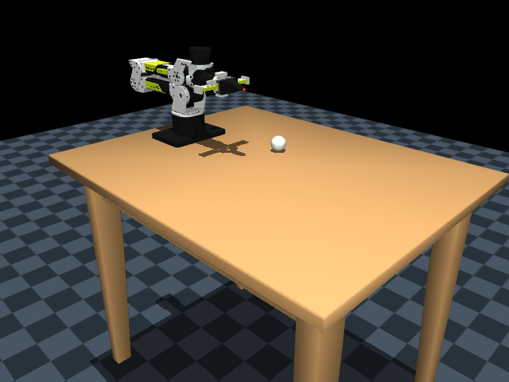

# Scene Phase 1 — table and one loose ball

> **14 October 2026:** This document retains earlier measurements/history. The current ball is 42.7 mm / 45.9 g; the Blender table texture and optional golf-ball visual are installed. See [current grasp settings and validation](grasp-tuning.md) for the revised solver/contact parameters and staged tests.

Implemented on **13 October 2026**. The user confirmed the ROS runtime checks
listed below for the initial scene. In response to feedback, the table is now
smaller and the ball–table contact has rolling resistance. Offline model checks
for this revision passed on MuJoCo **3.12.0 and 3.15.0**; the user's rebuild and
visual/rolling check of this revision remain pending. These scene phases extend
the earlier arm/control integration; they do not replace its Phase 1 numbering.

**User-supplied results:** three active controllers, seven available/claimed
position interfaces, 16 state interfaces, one joint-state publisher, and clock
advancing from 68.937999999 to 77.108000000 seconds. Joint1 to +0.2 rad and joint2
to -0.2 rad both returned `SUCCEEDED`, error code 0. A joint-state message arrived
after one CLI missed-message notice. Effort values are NaN because effort state
interfaces are not exported. No build transcript or physical grasp result was
supplied. These results establish working ROS control, not calibrated ball physics.

## Agreed stages

1. Table and one loose native sphere: loading, placement, gravity, reset, and
   existing controller readiness. This document covers this stage.
2. One bowl and one ball: correct bowl scale/orientation/contact walls, matching
   MoveIt scene and object-state integration, then first grasp/release checks.
3. Three bowls and the full ball layout, including the user's mesh golf balls,
   followed by transfer tests and performance checks.

The initial stage deferred review comments 15/16. After observing long rolling,
the user requested physics improvements; [ball physics tests](ball-physics.md)
now describe a specific rolling-resistance pair and calibration procedure.
The real surface/ball remain undecided, so the values are estimates. The chosen
bowl remains `ws_projects/src/scene obj/urdf/mycobot_pro_450/meshes_mujoco/wooden_bowl.obj`.

## Contents and coordinates

| Item | Phase 1 specification |
|---|---|
| Frames | World and `base_link` coincide, robot base at `(0, 0, 0)` |
| Table export | User's +Z-up, -Y-forward mesh; scale `(0.4, 0.5333333333, 1)`, no rotation |
| Table position | `(0.35, 0, 0)` m; near edge X = -0.15 m |
| Table dimensions | 1.0 × 0.8 m; top at Z = 0; thickness 0.032 m; height 0.8 m |
| Table collisions | Nine boxes enclosing the top, four legs, and four supports |
| Floor | Z = -0.8 m |
| Ball | `loose_ball_1`, radius 0.0225 m, mass 0.045 kg |
| Initial ball centre | `(0.30, 0.10, 0.030)` m; bottom starts 7.5 mm above table |
| Ball inertia | Solid-sphere assumption, diagonal 9.1125e-6 kg·m² |

An asset's “forward” direction does not redefine the robot's base axes. The
table retains its exported orientation; pose commands still use the robot's
`base_link`. The table's long dimension lies along X. The later golf mesh also
retains +Z up and -Y forward. The bowl needs a separate axis check.

The original OBJ/MTL files were copied unchanged into `scene_assets/` and are
installed by `setup.py`. MJCF supplies the table colour. Both engines accepted
the source polygons; the 3.15 model inspection reported 416 mesh triangles.
Re-exporting was not needed. The table mesh is visual only; collision boxes approximate its bevels.

`dm_arm.xml` only changes how external meshes are referenced. Robot joints,
actuators, inertias, collision vertices, and saved arm poses are unchanged.
Explicit paths avoid a shared `meshdir` conflicting with scene assets.
`prepare_scene()` resolves installed paths in a temporary copy, including
installations where bringup and DM are in different prefixes.

MuJoCo 3.12 filled omitted ball keyframe positions with zeros, while 3.15 used
the body's initial position. Launch preparation now explicitly appends the
free-body pose to every keyframe. Reset therefore restores the ball as well
as the arm; this is a simulator reset, not a robot home trajectory.

`generate_model.py` regenerates `dm_arm.xml` and the robot-only `dm_empty.xml`,
but preserves an existing `dm_scene.xml` so later scene edits survive regeneration.

## Run the checks yourself

Stop your previous simulation, then in terminal 1:

```bash
source /opt/ros/humble/setup.bash
cd ~/si_ware/documents/rebot_arm_b601/ws_projects
colcon build --symlink-install --packages-up-to rebotarm_mujoco_dm
source install/setup.bash
ros2 launch rebotarm_mujoco_dm mujoco_dm.launch.py scene:=table use_moveit:=false
```

Expected: the DM arm stands near the table edge, a single white ball sits at
X = 300 mm, Y = 100 mm, and the legs meet the floor. The ball drops a short
distance on startup, then rests. The three existing controllers activate.
For a clean visual view, hide geom group 3 in MuJoCo; enable it when checking
the collision boxes. Visibility does not change contact behaviour.

In terminal 2:

```bash
source /opt/ros/humble/setup.bash
source ~/si_ware/documents/rebot_arm_b601/ws_projects/install/setup.bash
ros2 control list_controllers
ros2 control list_hardware_interfaces
ros2 topic info /joint_states -v
ros2 topic echo /joint_states --once
ros2 topic echo /clock --once
ros2 topic echo /clock --once
```

Expect three active controllers, seven claimed position command interfaces,
16 robot state interfaces, one joint-state publisher, and increasing clock
values. The ball has a free joint in physics, but is not a robot controller
joint; these commands do not report its pose.

The initial-scene ROS outputs above have been received. After rebuilding this
revision, confirm that the smaller table looks appropriate and compare rolling
using the repeatable tests in [ball-physics.md](ball-physics.md).

For a separate standalone visual check with the installed 3.15 app:

```bash
cd ~/si_ware/documents/rebot_arm_b601
~/.mujoco/mujoco-3.15.0/bin/simulate \
  ws_projects/src/rebotarm_ros2/src/rebotarm_mujoco_dm/models/dm_scene.xml
```

This is an independent simulation. Do not use it as the source of ROS object
state. Direct source keyframe defaults were checked on 3.15; the 3.12 ROS
launch uses the prepared scene with explicit complete keyframes.

## MoveIt during this stage

Matching environment obstacles and measured ball-state updates belong to scene
Phase 2. The launch currently rejects `scene:=table use_moveit:=true` rather
than letting MoveIt plan through objects it cannot see. Controller-only motion
has no MoveIt collision planning. This stage's requested checks are placement,
settling, and controller readiness, not grasping or old demo motions near objects.

For the previous MoveIt demos and SDK pose action, stop the table launch and use:

```bash
ros2 launch rebotarm_mujoco_dm mujoco_dm.launch.py scene:=empty use_moveit:=true
```

`scene:=empty` selects the preserved original floor-only environment. The new
default scene is `table`; keep this argument explicit when repeating old tests.

## Offline results

| Check | Result |
|---|---|
| Prepared scene, both engine versions | Loaded; `nq=15`, `nv=14`, seven actuators |
| Home, ready, pose_a, pose_b | Correct ball reset position; no initial contacts |
| Five-second hold at each of four poses, each engine | Zero warnings; fixed base; ball supported by tabletop |
| Settled ball centre, both versions | Approximately `(0.30, 0.1, 0.022409145)` m |
| Final ball generalized speed maximum | About 1.677e-12 (linear m/s or angular rad/s components) |
| Settled penetration | About 0.090855 mm, with the ball–table pair |
| Contact at the end of each hold | Ball–tabletop only |
| Isolated asset prefixes and missing asset error | Unit test passed |
| Explicit free-body keyframe reset | Unit test passed |
| Staged package assets, both scenes and both engines | Loaded from a separate temporary package prefix |

The initial scene's ROS launch/control is user-verified; grasping and MoveIt
scene synchronisation remain pending. Static saved poses being clear does not
prove that paths between them are clear. Physics values still require calibration.

The repeatable offline check is `tools/validate_scene.py --probe PATH_TO_MODEL_PROBE`.
Compile `tools/model_probe.cpp` against the desired engine as in the package
README. It tests the prepared model without a ROS graph or GUI. For the original
robot-only regression checks, `tools/validate_model.py` now uses `dm_empty.xml`.


